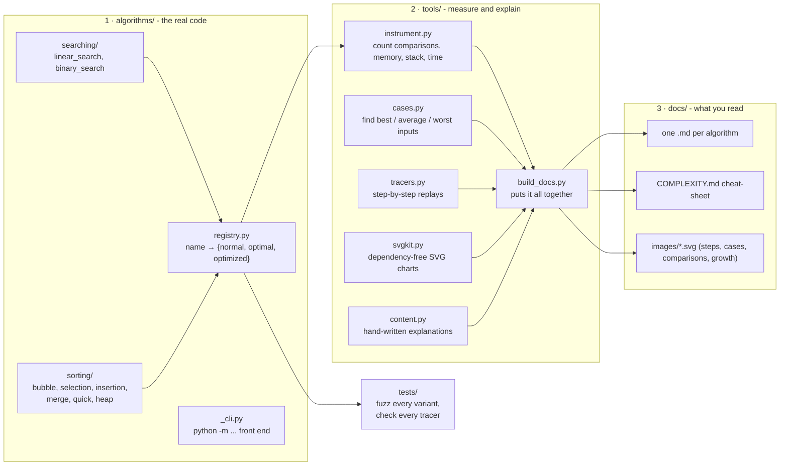

# Architecture

The repo has three layers. Each layer only depends on the one above it, so you can read, run, test or
regenerate any of them on its own.



## Layout

```
algorithms/
  searching/{linear_search,binary_search}.py
  sorting/{bubble,selection,insertion,merge,quick,heap}_sort.py
  registry.py            # SORTS / SEARCHES: name -> {"normal","optimal","optimized"} functions
  _cli.py                # shared stdin front end (--variant normal|optimal|optimized)
tools/                   # everything that measures, traces, draws, writes docs
tests/                   # unittest: fuzzing + tracer checks
docs/                    # generated *.md + images/, plus your original screenshots/
```

## The three-tier contract

Every algorithm module exports the same shape, so tools and tests can treat all of them uniformly:

| Tier | Meaning | Example (bubble sort) |
|---|---|---|
| **normal** | the textbook version | double loop, no early exit |
| **optimal** | the best Big-O this algorithm family can reach | stop when a pass makes no swap → best case O(n) |
| **optimized** | engineering tweaks you would ship | jump to the last swap position |

* Sorting functions sort **in place** and **return the same list**.
* Search functions return an **index** or **-1**.
* `VARIANTS = {"normal": ..., "optimal": ..., "optimized": ...}` at the bottom of every module.

## Where the numbers come from

Nothing in `docs/` is typed in by hand except the explanations in `tools/content.py`.
`python -m tools.build_docs` runs the real functions with a `Tracked` int that counts every comparison,
`tracemalloc` for extra memory, a profile hook for call-stack depth and `perf_counter` for time, and picks
each algorithm's best / worst case by **trying many input shapes** (sorted, reversed, all-equal, organ-pipe,
saw-tooth, plus constructed adversarial permutations for merge and quick sort) and taking the min / max.

## Adding an algorithm

1. Add `algorithms/<group>/<name>.py` with `<name>_normal/_optimal/_optimized` and `VARIANTS`.
2. Register it in `algorithms/registry.py`.
3. Add its text to `tools/content.py` and a tracer in `tools/tracers.py`.
4. `python -m unittest discover -s tests -t .` then `python -m tools.build_docs`.

## Behaviour changes from the original flat scripts

| Before | Now | Why |
|---|---|---|
| `python bubble_sort.py` | `python -m algorithms.sorting.bubble_sort` | scripts became an importable package |
| bubble & selection sort sorted **descending**; the rest ascending | all sort **ascending** | one consistent contract |
| quick sort popped items out of the caller's list (destroying it) | sorts in place and returns the list | no hidden mutation |
| searches returned the string `"NOT FOUND"` | return `-1`; the CLI still prints `NOT FOUND` | a function should return one type |
| binary-search CLI trusted the input to be sorted | CLI sorts the input first | wrong answers on unsorted input |
| screenshots in `Algorithm Logic SS/` | `docs/screenshots/` | all docs assets together |

No algorithm logic was lost: each original implementation survives as the **normal** (or, for bubble sort's
early-exit flag, the **optimal**) tier.
