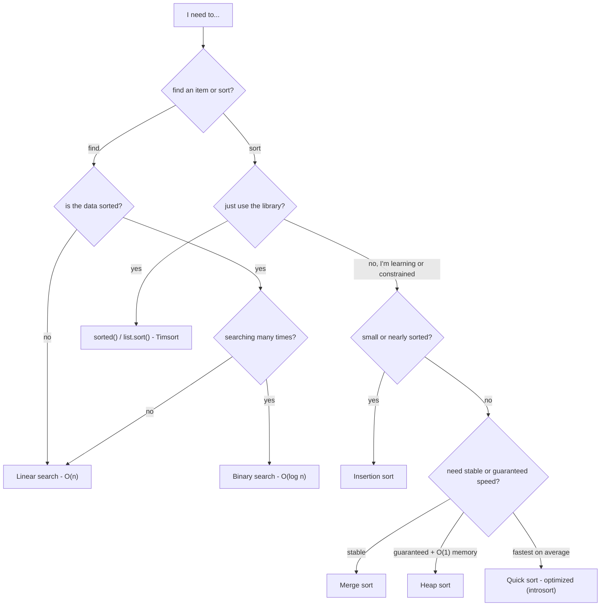

# Complexity cheat-sheet

All numbers on the algorithm pages are **measured** by running the code in `algorithms/`
(`python -m tools.build_docs` regenerates them). This page is the one-screen summary.

## Searching

| Algorithm | Best | Average | Worst | Space | Needs sorted input |
|---|---|---|---|---|---|
| [Linear Search](linear_search.md) | O(1) | O(n) | O(n) | O(1) | No |
| [Binary Search](binary_search.md) | O(1) | O(log n) | O(log n) | O(1) | Yes |

## Sorting

| Algorithm | Best | Average | Worst | Space | Stable | Avg comparisons @ n=64 (optimal tier) |
|---|---|---|---|---|---|---|
| [Bubble Sort](bubble_sort.md) | O(n) | O(n²) | O(n²) | O(1) | Yes | 1,970 |
| [Selection Sort](selection_sort.md) | O(n²) | O(n²) | O(n²) | O(1) | No | 2,016 |
| [Insertion Sort](insertion_sort.md) | O(n) | O(n²) | O(n²) | O(1) | Yes | 1,118 |
| [Merge Sort](merge_sort.md) | O(n log n) | O(n log n) | O(n log n) | O(n) | Yes | 307 |
| [Quick Sort](quick_sort.md) | O(n log n) | O(n log n) | O(n²) (duplicates; astronomically rare otherwise) | O(log n) | No | 363 |
| [Heap Sort](heap_sort.md) | O(n log n) | O(n log n) | O(n log n) | O(1) | No | 571 |

## Is O(n log n) the limit? (the "optimal" question)

Any sort that works **only by comparing items** needs at least log₂(n!) ≈ n·log₂ n comparisons in the worst
case: there are n! possible orders, and each comparison has two outcomes, so you need ≥ log₂(n!) comparisons to
tell them apart. So **O(n log n) is the optimal complexity class** for comparison sorting, and merge sort, heap
sort and (introsort-style) quick sort all reach it. Bubble, selection and insertion sort do not - their value is
simplicity, tiny constant factors on small inputs, or adaptivity.
Sorts that *don't* compare (counting / radix / bucket sort) can reach O(n + k) when keys are small integers.

Python's built-in `sorted()` / `list.sort()` is **Timsort**: a stable merge-sort/insertion-sort hybrid that is
O(n) on already-sorted data and O(n log n) otherwise ([Timsort on Wikipedia](https://en.wikipedia.org/wiki/Timsort)).
The optimized tiers here borrow its ideas (insertion-sort cutoff, skipping merges of ordered runs).

## Which algorithm should I use?

## The three tiers, in one table

| Algorithm | Normal (textbook) | Optimal (best Big-O for the family) | Optimized (what you'd ship) |
|---|---|---|---|
| [Linear Search](linear_search.md) | The textbook `for` loop. | **Sentinel search**: place the key at the end so the loop needs no bounds check. | Use `list.index` - the same scan, executed by CPython's C loop. |
| [Binary Search](binary_search.md) | Classic loop: compare `==`, then `<`; `end = mid − 1`. | **Lower-bound** form on a half-open window `[lo, hi)`: ONE comparison per iteration, returns the first occurrence. | **Interpolation search**: probe `lo + (key−a[lo])·(hi−lo)/(a[hi]−a[lo])`. |
| [Bubble Sort](bubble_sort.md) | Textbook double loop, no early exit. | Add a `swapped` flag and stop when a pass changes nothing. | Remember the position of the **last swap**; everything after it is already sorted, so the next pass can end there. |
| [Selection Sort](selection_sort.md) | Textbook version: always swap, even with itself. | Skip the last pass and skip swaps when the minimum is already in place. | **Double-ended selection**: each pass places the minimum **and** the maximum, comparing items in pairs (3 comparisons per 2 items instead of 4). |
| [Insertion Sort](insertion_sort.md) | Swap the item left one step at a time. | Hold the item aside and **shift** bigger items right (no swaps). | **Binary insertion**: find the spot with binary search (O(log i) comparisons), then move the item with one C-level `pop`/`insert`; check `a[i-1] <= item` first so sorted input stays O(n). |
| [Merge Sort](merge_sort.md) | Slice into new left/right lists, sort recursively, merge back. | One reusable half-size buffer; merge in place into the original list. | Add an **insertion-sort cutoff** for ranges ≤ 8 and **skip** the merge when the two halves are already ordered. |
| [Quick Sort](quick_sort.md) | Last element as pivot; build `lower` and `greater` lists; concatenate. | In-place Lomuto partition + **random pivot** + recurse into the smaller side. | **Introsort**: median-of-three pivot, 3-way partition, insertion-sort cutoff (16), smaller-side recursion, heap-sort fallback at depth 2·log₂ n. |
| [Heap Sort](heap_sort.md) | Recursive `heapify`; build from index n//2−1 down to 0. | Iterative sift-down loop - no recursion. | **Bottom-up sift** (Floyd): slide the hole to a leaf along the larger children, then climb back to where the item fits. |

## References

- [Time and Space Complexities of Sorting Algorithms Explained (Interview Kickstart)](https://interviewkickstart.com/blogs/learn/time-complexities-of-all-sorting-algorithms)
- [Sorting Algorithms Cheat Sheet (NeetCode)](https://neetcode.io/cheatsheets/sorting-algorithms)
- [Introsort (Wikipedia)](https://en.wikipedia.org/wiki/Introsort)
- [Timsort (Wikipedia)](https://en.wikipedia.org/wiki/Timsort)
- [Introspective Sorting and Selection Algorithms - Musser (PDF)](https://webpages.charlotte.edu/rbunescu/courses/ou/cs4040/introsort.pdf)
- [Searching Algorithms overview (archman.dev)](https://archman.dev/docs/algorithms-and-data-structures/sorting-and-searching/searching-algorithms)
