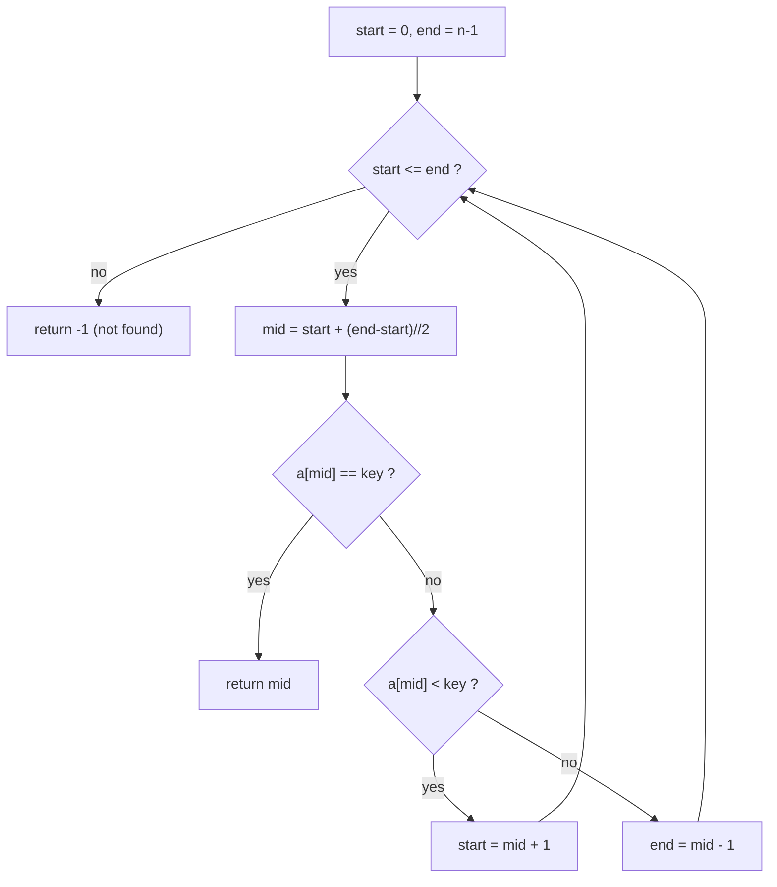

# Binary Search

> In a sorted array, look at the middle and throw away the half that cannot contain the key.


[← All algorithms](../README.md) · Source: [`algorithms/searching/binary_search.py`](../algorithms/searching/binary_search.py) ·
Original hand-drawn notes: [`screenshots/binary_search.png`](screenshots/binary_search.png)

## Quick answers

**What is the time complexity of binary search?**  
Best case **O(1)**, average case **O(log n)**, worst case **O(log n)** (normal tier; the optimal and optimized tiers differ - see the table below).

**What is the space complexity of binary search?**  
**O(1)** extra space (normal tier).

**Best case / average case / worst case - what input causes each?**  
- **Best:** middle key, evenly spaced data → 1 comparisons at n = 63 (normal tier)
- **Average:** every present key, evenly spaced data → 9.2 comparisons at n = 63 (normal tier)
- **Worst:** missing (too small) key, evenly spaced data → 12 comparisons at n = 63 (normal tier)

**Is it stable / in place / adaptive?**  
Stable: n/a · In place: Yes · Adaptive: Needs SORTED input

**Normal vs optimal vs optimized solution?**  
See [section 6](#6-normal-vs-optimal-vs-optimized-solutions).

**Why `mid = start + (end - start) // 2` and not `(start + end) // 2`?**  
In C/Java `start + end` can overflow a 32-bit int. Python ints don't overflow, but the safe form is a good habit.


### Complexity at a glance

| Tier | Best | Average | Worst | Space |
|---|---|---|---|---|
| **Normal** | O(1) | O(log n) | O(log n) | O(1) |
| **Optimal** | O(log n) | O(log n) | O(log n) | O(1) |
| **Optimized** | O(1) | O(log log n) on evenly spread data | O(n) on skewed data | O(1) |

## 1. How it works - step by step



1. **Requirement:** the array must already be sorted ascending.
2. Keep a window `[start, end]`, initially the whole array.
3. Look at the middle element `mid`. If it equals the key → done.
4. If `arr[mid] < key`, the key can only be on the **right** → `start = mid + 1`. Otherwise it can only be on the **left** → `end = mid − 1`.
5. Repeat. If the window becomes empty (`start > end`) the key is not present.

## 2. Worked example

Searching the example below, one step at a time (every row is a snapshot taken by
[`tools/tracers.py`](../tools/tracers.py), which is tested to end in the right answer).

| # | What happens | Array after the step |
|---|---|---|
| 1 | Looking for 23 in a SORTED array. Window = whole array. | `[2, 5, 8, 12, 16, 23, 38, 56, 72, 91]` |
| 2 | mid = 4: 16 < 23, so the key is to the right: lo = 5. | `[2, 5, 8, 12, 16, 23, 38, 56, 72, 91]` |
| 3 | mid = 7: 56 > 23, so the key is to the left: hi = 6. | `[2, 5, 8, 12, 16, 23, 38, 56, 72, 91]` |
| 4 | mid = 5: a[5] = 23 equals 23: FOUND. | `[2, 5, 8, 12, 16, 23, 38, 56, 72, 91]` |

## 3. Visual cases - best, average, worst


The picture shows the **input** that triggers each case. Bars are values (sorting) or sorted/unsorted data
with the searched key highlighted (searching).

**Comparisons, n = 63** (each cell: count and the input that produced it)

| Tier | Best | Average | Worst |
|---|---|---|---|
| **Normal** | 1 <br><sub>middle key, evenly spaced data</sub> | 9.2 <br><sub>every present key, evenly spaced data</sub> | 12 <br><sub>missing (too small) key, evenly spaced data</sub> |
| **Optimal** | 6 <br><sub>missing (too large) key, evenly spaced data</sub> | 7 <br><sub>every present key, evenly spaced data</sub> | 7 <br><sub>first key, evenly spaced data</sub> |
| **Optimized** | 1 <br><sub>missing (too small) key, evenly spaced data</sub> | 4 <br><sub>every present key, evenly spaced data</sub> | 161 <br><sub>missing (in a gap) key, geometric (powers of 2) data</sub> |

| Tier | Time per search (µs, n=100,000, key absent) |
|---|---|
| **Normal** | 1.8 |
| **Optimal** | 1.3 |
| **Optimized** | 0.3 |

<sub>Timings are indicative only (CPython 3.13.16, one machine); comparison counts, memory and stack depth are deterministic.</sub>


## 4. Time complexity - step by step

1. **Each step halves the window:** n → n/2 → n/4 → … → 1. The number of halvings is **⌊log₂ n⌋ + 1** → O(log n). A million items need ≤ 20 steps; a billion ≤ 30.
2. **Best case:** the key is exactly in the middle → **1 comparison, O(1)** (normal tier).
3. **Worst case:** the key is missing or found at the very last step → ⌊log₂ n⌋ + 1 iterations (×2 comparisons per iteration in the normal tier because of `==` then `<`).
4. **Average case:** ≈ log₂ n − 1 iterations → O(log n).
5. **Trade-off in the optimal tier:** one comparison per iteration (`<` only) and it always runs the full ⌈log₂ n⌉ iterations - so no lucky O(1) exit, but fewer total comparisons on average and the **first** match is returned.
6. **Optimized (interpolation):** guesses the position from the key's value. On evenly spread data ≈ log₂ log₂ n probes; on skewed data (powers of 2) it can crawl at O(n).


## 5. Space complexity - step by step

1. Iterative: `start`, `end`, `mid` → **O(1)**. (A recursive version would use O(log n) stack.)
2. Input is **not** copied.

## 6. Normal vs optimal vs optimized solutions

| | Normal | Optimal | Optimized |
|---|---|---|---|
| **Idea** | Classic loop: compare `==`, then `<`; `end = mid − 1`. | **Lower-bound** form on a half-open window `[lo, hi)`: ONE comparison per iteration, returns the first occurrence. | **Interpolation search**: probe `lo + (key−a[lo])·(hi−lo)/(a[hi]−a[lo])`. |
| **Why it matters** | 2 comparisons per iteration. | ≈ log₂ n comparisons - the information-theoretic minimum - so O(log n) cannot be beaten by comparison-based search. Python ships this as `bisect.bisect_left`. | Fastest on uniformly distributed numbers; falls back to O(n) on skewed data and needs numeric keys. Early range check rejects out-of-range keys in O(1). |

*Normal* = the textbook version. *Optimal* = the best Big-O this algorithm family can reach.
*Optimized* = engineering tweaks you would ship (constant factors, memory, robustness).

### Normal - `binary_search_normal`

**Idea:** Classic loop: compare `==`, then `<`; `end = mid − 1`.

2 comparisons per iteration.

| Best | Average | Worst | Space |
|---|---|---|---|
| O(1) | O(log n) | O(log n) | O(1) |

```python
def binary_search_normal(arr, key):
    """Normal: classic three-way compare (==, then <) on the middle element."""
    start, end = 0, len(arr) - 1
    while start <= end:
        mid = start + (end - start) // 2      # never overflows in C/Java either
        if arr[mid] == key:
            return mid
        elif arr[mid] < key:
            start = mid + 1
        else:
            end = mid - 1
    return -1
```

### Optimal - `binary_search_optimal`

**Idea:** **Lower-bound** form on a half-open window `[lo, hi)`: ONE comparison per iteration, returns the first occurrence.

≈ log₂ n comparisons - the information-theoretic minimum - so O(log n) cannot be beaten by comparison-based search. Python ships this as `bisect.bisect_left`.

| Best | Average | Worst | Space |
|---|---|---|---|
| O(log n) | O(log n) | O(log n) | O(1) |

```python
def binary_search_optimal(arr, key):
    """Optimal: "lower bound" form - ONE comparison per step, returns the FIRST match.

    Floor(log2 n) + 1 comparisons is the information-theoretic minimum for a
    comparison-based search, so no algorithm can beat O(log n) here.
    The half-open window [lo, hi) removes the off-by-one traps of `end = mid - 1`.
    """
    lo, hi = 0, len(arr)
    while lo < hi:
        mid = lo + (hi - lo) // 2
        if arr[mid] < key:
            lo = mid + 1
        else:
            hi = mid
    return lo if lo < len(arr) and arr[lo] == key else -1
```

### Optimized - `binary_search_optimized`

**Idea:** **Interpolation search**: probe `lo + (key−a[lo])·(hi−lo)/(a[hi]−a[lo])`.

Fastest on uniformly distributed numbers; falls back to O(n) on skewed data and needs numeric keys. Early range check rejects out-of-range keys in O(1).

| Best | Average | Worst | Space |
|---|---|---|---|
| O(1) | O(log log n) on evenly spread data | O(n) on skewed data | O(1) |

```python
def binary_search_optimized(arr, key):
    """Optimized: interpolation search - guess WHERE the key should be.

    Probes lo + (key - arr[lo]) * (hi - lo) / (arr[hi] - arr[lo]) instead of the
    middle.  On evenly spread numbers it needs ~log2(log2 n) probes; on skewed
    data (e.g. powers of two) it degrades to O(n).  Numbers only (needs subtraction).
    In production Python, prefer `bisect.bisect_left` (a C implementation of the
    optimal version above).
    """
    lo, hi = 0, len(arr) - 1
    while lo <= hi and arr[lo] <= key <= arr[hi]:
        if arr[hi] == arr[lo]:                 # flat window: avoid divide-by-zero
            return lo if arr[lo] == key else -1
        pos = lo + (key - arr[lo]) * (hi - lo) // (arr[hi] - arr[lo])
        if arr[pos] == key:
            return pos
        if arr[pos] < key:
            lo = pos + 1
        else:
            hi = pos - 1
    return -1
```

## 7. When to use it

Sorted data that is searched many times (sorting once costs O(n log n), each search then O(log n)). Also the idea behind `bisect`, database indexes and "binary search on the answer" problems.

## Further reading

- [Searching Algorithms overview (archman.dev)](https://archman.dev/docs/algorithms-and-data-structures/sorting-and-searching/searching-algorithms)
