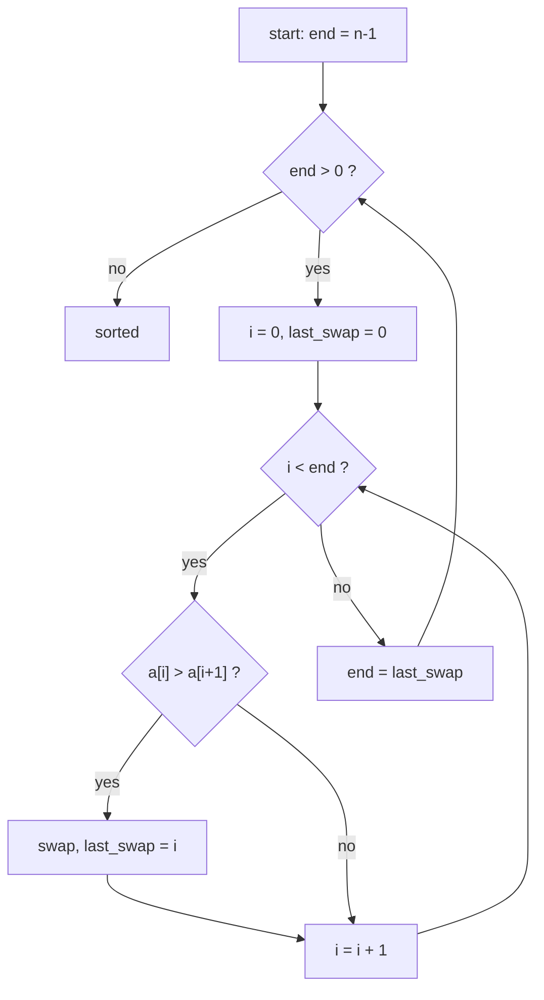

# Bubble Sort

> Swap neighbours that are out of order; each pass floats the largest remaining value to the end.


[← All algorithms](../README.md) · Source: [`algorithms/sorting/bubble_sort.py`](../algorithms/sorting/bubble_sort.py) ·
Original hand-drawn notes: [`screenshots/bubble_sort.png`](screenshots/bubble_sort.png)

## Quick answers

**What is the time complexity of bubble sort?**  
Best case **O(n)**, average case **O(n²)**, worst case **O(n²)** (optimal tier; the normal tier differ - see the table below).

**What is the space complexity of bubble sort?**  
**O(1)** extra space (optimal tier).

**Best case / average case / worst case - what input causes each?**  
- **Best:** sorted → 63 comparisons at n = 64 (optimal tier)
- **Average:** random → 1,970 comparisons at n = 64 (optimal tier)
- **Worst:** reversed → 2,016 comparisons at n = 64 (optimal tier)

**Is it stable / in place / adaptive?**  
Stable: Yes · In place: Yes · Adaptive: Only with the early-exit flag

**Normal vs optimal vs optimized solution?**  
See [section 6](#6-normal-vs-optimal-vs-optimized-solutions).

**Is bubble sort ever the best choice?**  
Almost never. Insertion sort has the same best/worst complexity and does less work per step.


### Complexity at a glance

| Tier | Best | Average | Worst | Space |
|---|---|---|---|---|
| **Normal** | O(n²) | O(n²) | O(n²) | O(1) |
| **Optimal** | O(n) | O(n²) | O(n²) | O(1) |
| **Optimized** | O(n) | O(n²) | O(n²) | O(1) |

## 1. How it works - step by step



1. Look at the first two neighbours, `arr[0]` and `arr[1]`.
2. If the left one is **bigger**, swap them. Otherwise leave them.
3. Step one position right and repeat until you reach the end of the *unsorted* part. The biggest value has now "bubbled" to the end and is in its **final** slot.
4. Shrink the unsorted part by one (the last slot is finished) and start the next pass from the left.
5. **Optimal tier:** if a whole pass made **zero swaps**, nothing is out of order, so stop early.

## 2. Worked example

Sorting the example below, one step at a time (every row is a snapshot taken by
[`tools/tracers.py`](../tools/tracers.py), which is tested to end in the right answer).

| # | What happens | Array after the step |
|---|---|---|
| 1 | Start: unsorted array. | `[5, 2, 4, 6, 1, 3]` |
| 2 | Pass 1: 5 > 2, swap. | `[2, 5, 4, 6, 1, 3]` |
| 3 | Pass 1: 5 > 4, swap. | `[2, 4, 5, 6, 1, 3]` |
| 4 | Pass 1: 5 <= 6, keep. | `[2, 4, 5, 6, 1, 3]` |
| 5 | Pass 1: 6 > 1, swap. | `[2, 4, 5, 1, 6, 3]` |
| 6 | Pass 1: 6 > 3, swap. | `[2, 4, 5, 1, 3, 6]` |
| 7 | End of pass 1: 6 bubbled into its final slot. | `[2, 4, 5, 1, 3, 6]` |
| 8 | Pass 2: 2 <= 4, keep. | `[2, 4, 5, 1, 3, 6]` |
| 9 | Pass 2: 4 <= 5, keep. | `[2, 4, 5, 1, 3, 6]` |
| 10 | Pass 2: 5 > 1, swap. | `[2, 4, 1, 5, 3, 6]` |
| 11 | Pass 2: 5 > 3, swap. | `[2, 4, 1, 3, 5, 6]` |
| 12 | End of pass 2: 5 bubbled into its final slot. | `[2, 4, 1, 3, 5, 6]` |
| 13 | Pass 3: 2 <= 4, keep. | `[2, 4, 1, 3, 5, 6]` |
| 14 | Pass 3: 4 > 1, swap. | `[2, 1, 4, 3, 5, 6]` |
| 15 | Pass 3: 4 > 3, swap. | `[2, 1, 3, 4, 5, 6]` |
| 16 | End of pass 3: 4 bubbled into its final slot. | `[2, 1, 3, 4, 5, 6]` |
| 17 | Pass 4: 2 > 1, swap. | `[1, 2, 3, 4, 5, 6]` |
| 18 | Pass 4: 2 <= 3, keep. | `[1, 2, 3, 4, 5, 6]` |
| 19 | End of pass 4: 3 bubbled into its final slot. | `[1, 2, 3, 4, 5, 6]` |
| 20 | Pass 5: 1 <= 2, keep. | `[1, 2, 3, 4, 5, 6]` |
| 21 | Pass 5 made no swap, so the array is sorted: stop early. | `[1, 2, 3, 4, 5, 6]` |
| 22 | Sorted. | `[1, 2, 3, 4, 5, 6]` |

## 3. Visual cases - best, average, worst


The picture shows the **input** that triggers each case. Bars are values (sorting) or sorted/unsorted data
with the searched key highlighted (searching).

**Comparisons, n = 64** (each cell: count and the input that produced it)

| Tier | Best | Average | Worst |
|---|---|---|---|
| **Normal** | 2,016 <br><sub>sorted</sub> | 2,016 <br><sub>random</sub> | 2,016 <br><sub>sorted</sub> |
| **Optimal** | 63 <br><sub>sorted</sub> | 1,970 <br><sub>random</sub> | 2,016 <br><sub>reversed</sub> |
| **Optimized** | 63 <br><sub>sorted</sub> | 1,899 <br><sub>random</sub> | 2,016 <br><sub>reversed</sub> |

| Tier | Extra memory (KiB, n=3000 random) | Max call-stack depth (n=800 sorted) | Time (ms, n=2000 random) |
|---|---|---|---|
| **Normal** | 0.3 | 1 | 142.3 |
| **Optimal** | 0.3 | 1 | 140.7 |
| **Optimized** | 0.2 | 1 | 165.5 |

<sub>Timings are indicative only (CPython 3.13.16, one machine); comparison counts, memory and stack depth are deterministic.</sub>


## 4. Time complexity - step by step

1. **Count the comparisons.** Pass 1 compares n−1 pairs, pass 2 compares n−2, … the last pass compares 1. Total = (n−1) + (n−2) + … + 1 = **n(n−1)/2** → O(n²).
2. **Best case (already sorted).** Normal tier still does all n(n−1)/2 comparisons → O(n²). With the swap flag, pass 1 makes n−1 comparisons and **no swaps**, so we stop → **O(n)**.
3. **Worst case (reversed).** Every comparison swaps: n(n−1)/2 comparisons *and* n(n−1)/2 swaps → O(n²).
4. **Average case (random).** Each pair is inverted with probability ½, so about n(n−1)/4 swaps, and the flag almost never fires early → still ≈ n(n−1)/2 comparisons → O(n²).


## 5. Space complexity - step by step

1. Sorting happens inside the input list: no copy is made.
2. Extra variables are just `i`, the pass counter, the `swapped` flag and one temporary for a swap → **O(1)**.
3. No recursion, so no stack growth.

## 6. Normal vs optimal vs optimized solutions

| | Normal | Optimal | Optimized |
|---|---|---|---|
| **Idea** | Textbook double loop, no early exit. | Add a `swapped` flag and stop when a pass changes nothing. | Remember the position of the **last swap**; everything after it is already sorted, so the next pass can end there. |
| **Why it matters** | Always n(n−1)/2 comparisons, even when the input is already sorted. | Best case drops to O(n). This is the version most people mean by "bubble sort". (Sources disagree on bubble sort's best case: O(n) vs O(n²) - the difference is exactly this flag.) | Skips sorted tails in one jump. Big win when only a few items are out of place; no gain on random data. |

*Normal* = the textbook version. *Optimal* = the best Big-O this algorithm family can reach.
*Optimized* = engineering tweaks you would ship (constant factors, memory, robustness).

### Normal - `bubble_sort_normal`

**Idea:** Textbook double loop, no early exit.

Always n(n−1)/2 comparisons, even when the input is already sorted.

| Best | Average | Worst | Space |
|---|---|---|---|
| O(n²) | O(n²) | O(n²) | O(1) |

```python
def bubble_sort_normal(arr):
    """Normal: n-1 passes, always.  The sorted tail shrinks, but there is no early exit."""
    n = len(arr)
    for p in range(n - 1):
        for i in range(n - 1 - p):             # last p items are already in place
            if arr[i] > arr[i + 1]:
                arr[i], arr[i + 1] = arr[i + 1], arr[i]
    return arr
```

### Optimal - `bubble_sort_optimal`

**Idea:** Add a `swapped` flag and stop when a pass changes nothing.

Best case drops to O(n). This is the version most people mean by "bubble sort". (Sources disagree on bubble sort's best case: O(n) vs O(n²) - the difference is exactly this flag.)

| Best | Average | Worst | Space |
|---|---|---|---|
| O(n) | O(n²) | O(n²) | O(1) |

```python
def bubble_sort_optimal(arr):
    """Optimal: stop as soon as a whole pass makes no swap (that means "sorted").

    Turns the best case (already sorted input) from O(n^2) into O(n).
    """
    n = len(arr)
    for p in range(n - 1):
        swapped = False
        for i in range(n - 1 - p):
            if arr[i] > arr[i + 1]:
                arr[i], arr[i + 1] = arr[i + 1], arr[i]
                swapped = True
        if not swapped:
            break
    return arr
```

### Optimized - `bubble_sort_optimized`

**Idea:** Remember the position of the **last swap**; everything after it is already sorted, so the next pass can end there.

Skips sorted tails in one jump. Big win when only a few items are out of place; no gain on random data.

| Best | Average | Worst | Space |
|---|---|---|---|
| O(n) | O(n²) | O(n²) | O(1) |

```python
def bubble_sort_optimized(arr):
    """Optimized: remember WHERE the last swap happened; everything after it is sorted.

    Skips the already-sorted tail in one jump, so mostly-sorted data finishes in far
    fewer comparisons than the plain early-exit flag.
    """
    end = len(arr) - 1                          # last index that may still be unsorted
    while end > 0:
        last_swap = 0
        for i in range(end):
            if arr[i] > arr[i + 1]:
                arr[i], arr[i + 1] = arr[i + 1], arr[i]
                last_swap = i
        end = last_swap
    return arr
```

## 7. When to use it

Teaching and tiny or nearly-sorted inputs. For anything else prefer insertion sort (same O(n²), far fewer writes) or an O(n log n) sort.

## Further reading

- [Time and Space Complexities of Sorting Algorithms Explained (Interview Kickstart)](https://interviewkickstart.com/blogs/learn/time-complexities-of-all-sorting-algorithms)
- [Sorting Algorithms Cheat Sheet (NeetCode)](https://neetcode.io/cheatsheets/sorting-algorithms)
- [Introsort (Wikipedia)](https://en.wikipedia.org/wiki/Introsort)
- [Timsort (Wikipedia)](https://en.wikipedia.org/wiki/Timsort)
- [Introspective Sorting and Selection Algorithms - Musser (PDF)](https://webpages.charlotte.edu/rbunescu/courses/ou/cs4040/introsort.pdf)
