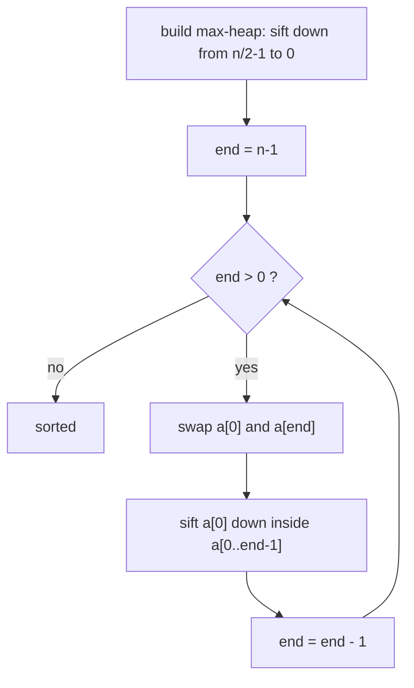

# Heap Sort

> Arrange the data as a max-heap, then repeatedly move the largest value to the end.


[← All algorithms](../README.md) · Source: [`algorithms/sorting/heap_sort.py`](../algorithms/sorting/heap_sort.py)

## Quick answers

**What is the time complexity of heap sort?**  
Best case **O(n log n)**, average case **O(n log n)**, worst case **O(n log n)** (normal tier; the optimal and optimized tiers differ - see the table below).

**What is the space complexity of heap sort?**  
**O(log n) recursion** extra space (normal tier); other tiers: optimal O(1), optimized O(1).

**Best case / average case / worst case - what input causes each?**  
- **Best:** all equal → 186 comparisons at n = 64 (normal tier)
- **Average:** random → 571 comparisons at n = 64 (normal tier)
- **Worst:** balanced-pivot permutation → 595 comparisons at n = 64 (normal tier)

**Is it stable / in place / adaptive?**  
Stable: No · In place: Yes · Adaptive: No

**Normal vs optimal vs optimized solution?**  
See [section 6](#6-normal-vs-optimal-vs-optimized-solutions).


### Complexity at a glance

| Tier | Best | Average | Worst | Space |
|---|---|---|---|---|
| **Normal** | O(n log n) | O(n log n) | O(n log n) | O(log n) recursion |
| **Optimal** | O(n log n) | O(n log n) | O(n log n) | O(1) |
| **Optimized** | O(n log n) | O(n log n) | O(n log n) | O(1) |

## 1. How it works - step by step



1. Read the array as a binary tree: the children of index `i` are `2i+1` and `2i+2`.
2. **Build a max-heap** (every parent ≥ its children) by sifting each non-leaf node down, starting from the last parent `n//2 − 1` and moving to index 0. Now `arr[0]` is the largest value.
3. **Swap** the root with the last item of the heap. The largest value is now in its final slot; shrink the heap by one.
4. **Sift the new root down** to restore the heap property.
5. Repeat steps 3-4 until the heap has one item.

## 2. Worked example

Sorting the example below, one step at a time (every row is a snapshot taken by
[`tools/tracers.py`](../tools/tracers.py), which is tested to end in the right answer).

| # | What happens | Array after the step |
|---|---|---|
| 1 | Start: unsorted array (read it as a binary tree: children of i are 2i+1, 2i+2). | `[5, 2, 4, 6, 1, 3]` |
| 2 | Sift down: parent 2 < child 6, swap. | `[5, 6, 4, 2, 1, 3]` |
| 3 | Sift down: parent 5 < child 6, swap. | `[6, 5, 4, 2, 1, 3]` |
| 4 | Max-heap built: the largest item (6) is at index 0. | `[6, 5, 4, 2, 1, 3]` |
| 5 | Swap root with index 5: 6 is now final. | `[3, 5, 4, 2, 1, 6]` |
| 6 | Sift down: parent 3 < child 5, swap. | `[5, 3, 4, 2, 1, 6]` |
| 7 | Heap restored on indices 0..4. | `[5, 3, 4, 2, 1, 6]` |
| 8 | Swap root with index 4: 5 is now final. | `[1, 3, 4, 2, 5, 6]` |
| 9 | Sift down: parent 1 < child 4, swap. | `[4, 3, 1, 2, 5, 6]` |
| 10 | Heap restored on indices 0..3. | `[4, 3, 1, 2, 5, 6]` |
| 11 | Swap root with index 3: 4 is now final. | `[2, 3, 1, 4, 5, 6]` |
| 12 | Sift down: parent 2 < child 3, swap. | `[3, 2, 1, 4, 5, 6]` |
| 13 | Heap restored on indices 0..2. | `[3, 2, 1, 4, 5, 6]` |
| 14 | Swap root with index 2: 3 is now final. | `[1, 2, 3, 4, 5, 6]` |
| 15 | Sift down: parent 1 < child 2, swap. | `[2, 1, 3, 4, 5, 6]` |
| 16 | Heap restored on indices 0..1. | `[2, 1, 3, 4, 5, 6]` |
| 17 | Swap root with index 1: 2 is now final. | `[1, 2, 3, 4, 5, 6]` |
| 18 | Heap restored on indices 0..0. | `[1, 2, 3, 4, 5, 6]` |
| 19 | Sorted. | `[1, 2, 3, 4, 5, 6]` |

## 3. Visual cases - best, average, worst


The picture shows the **input** that triggers each case. Bars are values (sorting) or sorted/unsorted data
with the searched key highlighted (searching).

**Comparisons, n = 64** (each cell: count and the input that produced it)

| Tier | Best | Average | Worst |
|---|---|---|---|
| **Normal** | 186 <br><sub>all equal</sub> | 571 <br><sub>random</sub> | 595 <br><sub>balanced-pivot permutation</sub> |
| **Optimal** | 186 <br><sub>all equal</sub> | 571 <br><sub>random</sub> | 595 <br><sub>balanced-pivot permutation</sub> |
| **Optimized** | 389 <br><sub>sorted</sub> | 408 <br><sub>random</sub> | 454 <br><sub>reversed</sub> |

| Tier | Extra memory (KiB, n=3000 random) | Max call-stack depth (n=800 sorted) | Time (ms, n=2000 random) |
|---|---|---|---|
| **Normal** | 0.4 | 11 | 4.0 |
| **Optimal** | 0.3 | 3 | 4.4 |
| **Optimized** | 0.2 | 2 | 4.1 |

<sub>Timings are indicative only (CPython 3.13.16, one machine); comparison counts, memory and stack depth are deterministic.</sub>


## 4. Time complexity - step by step

1. **Build the heap:** a node at height h costs O(h) to sift, and there are ≈ n/2^(h+1) such nodes: Σ h·n/2^(h+1) = **O(n)** (not n log n - most nodes are near the bottom).
2. **Extract n−1 times:** each swap is O(1) and each sift-down goes at most log₂ n levels → (n−1)·log₂ n = **O(n log n)**.
3. **Best = average = worst = O(n log n)** for distinct keys: the heap's shape does not depend on the input order. (With **all-equal** keys, sifts stop immediately and the sort is O(n).)
4. **Normal sift costs 2 comparisons per level** (find the larger child, compare with the parent). The optimized *bottom-up* variant spends 1 per level on the way down, then a few on the way up ≈ n·log₂ n comparisons in total.


## 5. Space complexity - step by step

1. The heap lives **inside** the input array → no copy.
2. Normal tier: recursive `heapify` uses O(log n) stack. Optimal/optimized: iterative → **O(1)**.

## 6. Normal vs optimal vs optimized solutions

| | Normal | Optimal | Optimized |
|---|---|---|---|
| **Idea** | Recursive `heapify`; build from index n//2−1 down to 0. | Iterative sift-down loop - no recursion. | **Bottom-up sift** (Floyd): slide the hole to a leaf along the larger children, then climb back to where the item fits. |
| **Why it matters** | O(log n) recursion stack. | True O(1) extra space. | ≈ half the comparisons of the standard sift-down. |

*Normal* = the textbook version. *Optimal* = the best Big-O this algorithm family can reach.
*Optimized* = engineering tweaks you would ship (constant factors, memory, robustness).

### Normal - `heap_sort_normal`

**Idea:** Recursive `heapify`; build from index n//2−1 down to 0.

O(log n) recursion stack.

| Best | Average | Worst | Space |
|---|---|---|---|
| O(n log n) | O(n log n) | O(n log n) | O(log n) recursion |

```python
def heap_sort_normal(arr):
    """Normal: recursive heapify. Leaves (index >= n//2) are already heaps, so skip them."""
    n = len(arr)
    for i in range(n // 2 - 1, -1, -1):         # build max-heap bottom-up
        _heapify(arr, n, i)
    for end in range(n - 1, 0, -1):             # move current max to its final slot
        arr[0], arr[end] = arr[end], arr[0]
        _heapify(arr, end, 0)
    return arr
```

### Optimal - `heap_sort_optimal`

**Idea:** Iterative sift-down loop - no recursion.

True O(1) extra space.

| Best | Average | Worst | Space |
|---|---|---|---|
| O(n log n) | O(n log n) | O(n log n) | O(1) |

```python
def heap_sort_optimal(arr):
    """Optimal: iterative sift-down, so no recursion stack - truly O(1) extra space."""
    heapsort_range(arr, 0, len(arr))
    return arr
```

### Optimized - `heap_sort_optimized`

**Idea:** **Bottom-up sift** (Floyd): slide the hole to a leaf along the larger children, then climb back to where the item fits.

≈ half the comparisons of the standard sift-down.

| Best | Average | Worst | Space |
|---|---|---|---|
| O(n log n) | O(n log n) | O(n log n) | O(1) |

```python
def heap_sort_optimized(arr):
    """Optimized: bottom-up heapsort - about n*log2(n) comparisons instead of 2*n*log2(n)."""
    n = len(arr)
    for i in range(n // 2 - 1, -1, -1):
        _sift_down_bottom_up(arr, i, n)
    for end in range(n - 1, 0, -1):
        arr[0], arr[end] = arr[end], arr[0]
        _sift_down_bottom_up(arr, 0, end)
    return arr
```

## 7. When to use it

You need a hard O(n log n) worst case **and** O(1) extra memory (embedded systems, introsort's fallback). It is usually slower than quick sort because it jumps around memory (poor cache locality).

## Further reading

- [Time and Space Complexities of Sorting Algorithms Explained (Interview Kickstart)](https://interviewkickstart.com/blogs/learn/time-complexities-of-all-sorting-algorithms)
- [Sorting Algorithms Cheat Sheet (NeetCode)](https://neetcode.io/cheatsheets/sorting-algorithms)
- [Introsort (Wikipedia)](https://en.wikipedia.org/wiki/Introsort)
- [Timsort (Wikipedia)](https://en.wikipedia.org/wiki/Timsort)
- [Introspective Sorting and Selection Algorithms - Musser (PDF)](https://webpages.charlotte.edu/rbunescu/courses/ou/cs4040/introsort.pdf)
