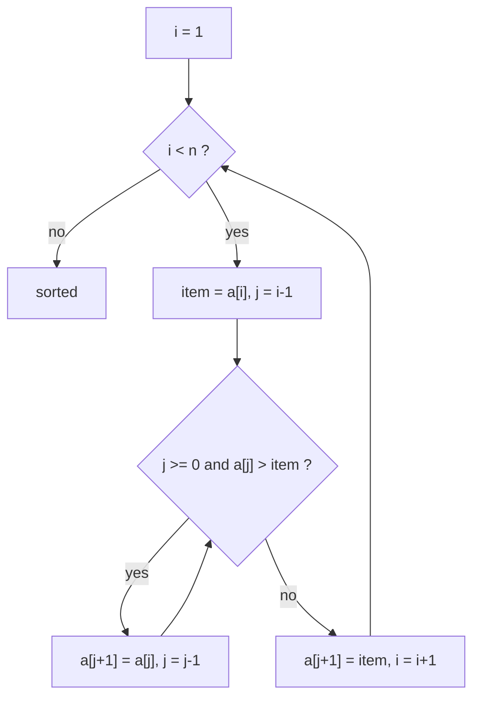

# Insertion Sort

> Grow a sorted prefix: take the next item and slide it left into its place - like sorting playing cards in your hand.


[← All algorithms](../README.md) · Source: [`algorithms/sorting/insertion_sort.py`](../algorithms/sorting/insertion_sort.py) ·
Original hand-drawn notes: [`screenshots/insertion_sort.png`](screenshots/insertion_sort.png)

## Quick answers

**What is the time complexity of insertion sort?**  
Best case **O(n)**, average case **O(n²)**, worst case **O(n²)** (optimal tier; the optimized tier differ - see the table below).

**What is the space complexity of insertion sort?**  
**O(1)** extra space (optimal tier).

**Best case / average case / worst case - what input causes each?**  
- **Best:** sorted → 63 comparisons at n = 64 (optimal tier)
- **Average:** random → 1,118 comparisons at n = 64 (optimal tier)
- **Worst:** reversed → 2,016 comparisons at n = 64 (optimal tier)

**Is it stable / in place / adaptive?**  
Stable: Yes · In place: Yes · Adaptive: Yes (O(n) on sorted input)

**Normal vs optimal vs optimized solution?**  
See [section 6](#6-normal-vs-optimal-vs-optimized-solutions).

**Why do real sort functions call insertion sort?**  
For tiny ranges its low overhead beats recursion; the O(n²) cost is irrelevant at n ≈ 16.


### Complexity at a glance

| Tier | Best | Average | Worst | Space |
|---|---|---|---|---|
| **Normal** | O(n) | O(n²) | O(n²) | O(1) |
| **Optimal** | O(n) | O(n²) | O(n²) | O(1) |
| **Optimized** | O(n) comparisons | O(n log n) comparisons, O(n²) moves | O(n log n) comparisons, O(n²) moves | O(1) |

## 1. How it works - step by step



1. The first element on its own is a sorted prefix of length 1.
2. Pick up the next element (`item`).
3. Walk left through the sorted prefix; every value **bigger** than `item` shifts one slot right.
4. Drop `item` into the gap that opens up. The sorted prefix is now one longer.
5. Repeat until the prefix covers the whole array.

## 2. Worked example

Sorting the example below, one step at a time (every row is a snapshot taken by
[`tools/tracers.py`](../tools/tracers.py), which is tested to end in the right answer).

| # | What happens | Array after the step |
|---|---|---|
| 1 | Start: a[0] alone is a sorted prefix. | `[5, 2, 4, 6, 1, 3]` |
| 2 | Pick up 2; it must go into the sorted prefix [5]. | `[5, 2, 4, 6, 1, 3]` |
| 3 | 5 > 2: shift 5 right. | `[2, 5, 4, 6, 1, 3]` |
| 4 | Drop 2 at index 0. Prefix is sorted up to index 1. | `[2, 5, 4, 6, 1, 3]` |
| 5 | Pick up 4; it must go into the sorted prefix [2, 5]. | `[2, 5, 4, 6, 1, 3]` |
| 6 | 5 > 4: shift 5 right. | `[2, 4, 5, 6, 1, 3]` |
| 7 | Drop 4 at index 1. Prefix is sorted up to index 2. | `[2, 4, 5, 6, 1, 3]` |
| 8 | Pick up 6; it must go into the sorted prefix [2, 4, 5]. | `[2, 4, 5, 6, 1, 3]` |
| 9 | Drop 6 at index 3. Prefix is sorted up to index 3. | `[2, 4, 5, 6, 1, 3]` |
| 10 | Pick up 1; it must go into the sorted prefix [2, 4, 5, 6]. | `[2, 4, 5, 6, 1, 3]` |
| 11 | 6 > 1: shift 6 right. | `[2, 4, 5, 1, 6, 3]` |
| 12 | 5 > 1: shift 5 right. | `[2, 4, 1, 5, 6, 3]` |
| 13 | 4 > 1: shift 4 right. | `[2, 1, 4, 5, 6, 3]` |
| 14 | 2 > 1: shift 2 right. | `[1, 2, 4, 5, 6, 3]` |
| 15 | Drop 1 at index 0. Prefix is sorted up to index 4. | `[1, 2, 4, 5, 6, 3]` |
| 16 | Pick up 3; it must go into the sorted prefix [1, 2, 4, 5, 6]. | `[1, 2, 4, 5, 6, 3]` |
| 17 | 6 > 3: shift 6 right. | `[1, 2, 4, 5, 3, 6]` |
| 18 | 5 > 3: shift 5 right. | `[1, 2, 4, 3, 5, 6]` |
| 19 | 4 > 3: shift 4 right. | `[1, 2, 3, 4, 5, 6]` |
| 20 | Drop 3 at index 2. Prefix is sorted up to index 5. | `[1, 2, 3, 4, 5, 6]` |
| 21 | Sorted. | `[1, 2, 3, 4, 5, 6]` |

## 3. Visual cases - best, average, worst


The picture shows the **input** that triggers each case. Bars are values (sorting) or sorted/unsorted data
with the searched key highlighted (searching).

**Comparisons, n = 64** (each cell: count and the input that produced it)

| Tier | Best | Average | Worst |
|---|---|---|---|
| **Normal** | 63 <br><sub>sorted</sub> | 1,118 <br><sub>random</sub> | 2,016 <br><sub>reversed</sub> |
| **Optimal** | 63 <br><sub>sorted</sub> | 1,118 <br><sub>random</sub> | 2,016 <br><sub>reversed</sub> |
| **Optimized** | 63 <br><sub>sorted</sub> | 354 <br><sub>random</sub> | 384 <br><sub>reversed</sub> |

| Tier | Extra memory (KiB, n=3000 random) | Max call-stack depth (n=800 sorted) | Time (ms, n=2000 random) |
|---|---|---|---|
| **Normal** | 0.1 | 1 | 97.4 |
| **Optimal** | 0.1 | 1 | 71.7 |
| **Optimized** | 0.2 | 1 | 2.2 |

<sub>Timings are indicative only (CPython 3.13.16, one machine); comparison counts, memory and stack depth are deterministic.</sub>


## 4. Time complexity - step by step

1. **Count the work per item.** Inserting item i compares it with 0…i items of the sorted prefix.
2. **Best case (sorted):** each item is compared once and not moved → n−1 comparisons → **O(n)**.
3. **Worst case (reversed):** item i is bigger than nothing, so it travels all the way left: 1+2+…+(n−1) = n(n−1)/2 → **O(n²)**.
4. **Average case (random):** on average it travels half the prefix → ≈ n²/4 → **O(n²)**.
5. **Exact rule:** time = Θ(n + I), where I is the number of *inversions* (pairs out of order). That is why nearly-sorted data is fast.


## 5. Space complexity - step by step

1. One saved `item` and two indices → **O(1)**. The binary-insertion version still moves items with `list.insert/pop` (an in-place memmove), so it stays O(1) extra.

## 6. Normal vs optimal vs optimized solutions

| | Normal | Optimal | Optimized |
|---|---|---|---|
| **Idea** | Swap the item left one step at a time. | Hold the item aside and **shift** bigger items right (no swaps). | **Binary insertion**: find the spot with binary search (O(log i) comparisons), then move the item with one C-level `pop`/`insert`; check `a[i-1] <= item` first so sorted input stays O(n). |
| **Why it matters** | 3 writes per step. | Same comparisons, a third of the writes. Same big-O. | Comparisons fall to O(n log n); moves stay O(n²) but run as a memmove, so on random data this is dramatically faster in practice. |

*Normal* = the textbook version. *Optimal* = the best Big-O this algorithm family can reach.
*Optimized* = engineering tweaks you would ship (constant factors, memory, robustness).

### Normal - `insertion_sort_normal`

**Idea:** Swap the item left one step at a time.

3 writes per step.

| Best | Average | Worst | Space |
|---|---|---|---|
| O(n) | O(n²) | O(n²) | O(1) |

```python
def insertion_sort_normal(arr):
    """Normal: bubble the new item left with repeated swaps (3 writes per step)."""
    for i in range(1, len(arr)):
        while i > 0 and arr[i - 1] > arr[i]:
            arr[i], arr[i - 1] = arr[i - 1], arr[i]
            i -= 1
    return arr
```

### Optimal - `insertion_sort_optimal`

**Idea:** Hold the item aside and **shift** bigger items right (no swaps).

Same comparisons, a third of the writes. Same big-O.

| Best | Average | Worst | Space |
|---|---|---|---|
| O(n) | O(n²) | O(n²) | O(1) |

```python
def insertion_sort_optimal(arr):
    """Optimal: hold the item aside and SHIFT larger items right (1 write per step)."""
    for i in range(1, len(arr)):
        item = arr[i]
        j = i - 1
        while j >= 0 and arr[j] > item:
            arr[j + 1] = arr[j]
            j -= 1
        arr[j + 1] = item
    return arr
```

### Optimized - `insertion_sort_optimized`

**Idea:** **Binary insertion**: find the spot with binary search (O(log i) comparisons), then move the item with one C-level `pop`/`insert`; check `a[i-1] <= item` first so sorted input stays O(n).

Comparisons fall to O(n log n); moves stay O(n²) but run as a memmove, so on random data this is dramatically faster in practice.

| Best | Average | Worst | Space |
|---|---|---|---|
| O(n) comparisons | O(n log n) comparisons, O(n²) moves | O(n log n) comparisons, O(n²) moves | O(1) |

```python
def insertion_sort_optimized(arr):
    """Optimized: binary-search the insertion point, then move the item with C-level list.insert/pop.

    Comparisons drop from O(n^2) to O(n log n) (moves stay O(n^2), but a memmove is
    far cheaper than a Python loop).  A one-comparison check first keeps the O(n) best case.
    """
    for i in range(1, len(arr)):
        item = arr[i]
        if arr[i - 1] <= item:                  # already in place: the common sorted case
            continue
        lo, hi = 0, i                           # find first position whose value > item
        while lo < hi:
            mid = (lo + hi) // 2
            if item < arr[mid]:
                hi = mid
            else:
                lo = mid + 1
        arr.insert(lo, arr.pop(i))              # two C-level memmoves, no temporary copy
    return arr
```

## 7. When to use it

Small arrays (n < ~20-50), nearly-sorted data, streaming data (online). Real libraries use it as the finishing step inside quick sort / Timsort.

## Further reading

- [Time and Space Complexities of Sorting Algorithms Explained (Interview Kickstart)](https://interviewkickstart.com/blogs/learn/time-complexities-of-all-sorting-algorithms)
- [Sorting Algorithms Cheat Sheet (NeetCode)](https://neetcode.io/cheatsheets/sorting-algorithms)
- [Introsort (Wikipedia)](https://en.wikipedia.org/wiki/Introsort)
- [Timsort (Wikipedia)](https://en.wikipedia.org/wiki/Timsort)
- [Introspective Sorting and Selection Algorithms - Musser (PDF)](https://webpages.charlotte.edu/rbunescu/courses/ou/cs4040/introsort.pdf)
