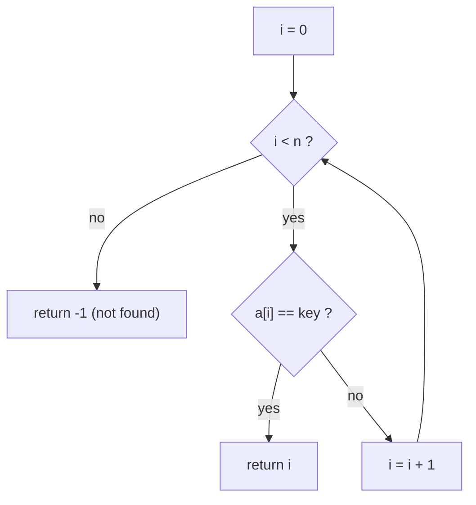

# Linear Search

> Check every element, one by one, until you find the key or run out of elements.


[← All algorithms](../README.md) · Source: [`algorithms/searching/linear_search.py`](../algorithms/searching/linear_search.py) ·
Original hand-drawn notes: [`screenshots/linear_search.png`](screenshots/linear_search.png)

## Quick answers

**What is the time complexity of linear search?**  
Best case **O(1)**, average case **O(n)**, worst case **O(n)** (normal tier; the same for every tier).

**What is the space complexity of linear search?**  
**O(1)** extra space (normal tier).

**Best case / average case / worst case - what input causes each?**  
- **Best:** first key, unsorted data → 1 comparisons at n = 63 (normal tier)
- **Average:** every present key, unsorted data → 32 comparisons at n = 63 (normal tier)
- **Worst:** last key, unsorted data → 63 comparisons at n = 63 (normal tier)

**Is it stable / in place / adaptive?**  
Stable: n/a · In place: Yes · Adaptive: Stops at the first match

**Normal vs optimal vs optimized solution?**  
See [section 6](#6-normal-vs-optimal-vs-optimized-solutions).

**When is linear search better than binary search?**  
When the data is unsorted, tiny, or searched only once - sorting costs O(n log n), more than one scan.


### Complexity at a glance

| Tier | Best | Average | Worst | Space |
|---|---|---|---|---|
| **Normal** | O(1) | O(n) | O(n) | O(1) |
| **Optimal** | O(1) | O(n) | O(n) | O(1) |
| **Optimized** | O(1) | O(n) | O(n) | O(1) |

## 1. How it works - step by step



1. Start at index 0.
2. Compare `arr[i]` with the key. If equal, return `i` - done.
3. Otherwise move to `i + 1`.
4. If you run past the last element, the key is not there: return −1 (`NOT FOUND`).

## 2. Worked example

Searching the example below, one step at a time (every row is a snapshot taken by
[`tools/tracers.py`](../tools/tracers.py), which is tested to end in the right answer).

| # | What happens | Array after the step |
|---|---|---|
| 1 | Looking for 9. Start at index 0. | `[8, 3, 5, 9, 2]` |
| 2 | a[0] = 8 is not 9: move on. | `[8, 3, 5, 9, 2]` |
| 3 | a[1] = 3 is not 9: move on. | `[8, 3, 5, 9, 2]` |
| 4 | a[2] = 5 is not 9: move on. | `[8, 3, 5, 9, 2]` |
| 5 | a[3] = 9 equals 9: FOUND at index 3. | `[8, 3, 5, 9, 2]` |

## 3. Visual cases - best, average, worst


The picture shows the **input** that triggers each case. Bars are values (sorting) or sorted/unsorted data
with the searched key highlighted (searching).

**Comparisons, n = 63** (each cell: count and the input that produced it)

| Tier | Best | Average | Worst |
|---|---|---|---|
| **Normal** | 1 <br><sub>first key, unsorted data</sub> | 32 <br><sub>every present key, unsorted data</sub> | 63 <br><sub>last key, unsorted data</sub> |
| **Optimal** | 1 <br><sub>first key, unsorted data</sub> | 32 <br><sub>every present key, unsorted data</sub> | 64 <br><sub>last key, unsorted data</sub> |
| **Optimized** | 1 <br><sub>first key, unsorted data</sub> | 32 <br><sub>every present key, unsorted data</sub> | 63 <br><sub>last key, unsorted data</sub> |

| Tier | Time per search (µs, n=100,000, key absent) |
|---|---|
| **Normal** | 4,447.2 |
| **Optimal** | 3,925.5 |
| **Optimized** | 1,144.6 |

<sub>Timings are indicative only (CPython 3.13.16, one machine); comparison counts, memory and stack depth are deterministic.</sub>


## 4. Time complexity - step by step

1. **Best case:** the key is the first element → **1 comparison, O(1)**.
2. **Worst case:** the key is last *or missing* → **n comparisons, O(n)**.
3. **Average case:** if the key is present and every position is equally likely, you look at (1+2+…+n)/n = **(n+1)/2** elements → O(n). A *missing* key always costs n.
4. **Why you can't beat it:** on unsorted data, any element you skip might be the key, so Ω(n) is unavoidable - linear search is *optimal* for unsorted data.


## 5. Space complexity - step by step

1. Only the index variable → **O(1)**. (The sentinel variant temporarily overwrites the last slot and restores it.)

## 6. Normal vs optimal vs optimized solutions

| | Normal | Optimal | Optimized |
|---|---|---|---|
| **Idea** | The textbook `for` loop. | **Sentinel search**: place the key at the end so the loop needs no bounds check. | Use `list.index` - the same scan, executed by CPython's C loop. |
| **Why it matters** | One comparison per element. | Asymptotically optimal already; this just trims the loop (about half the work per step in compiled languages). In CPython the benefit is small. | Same O(n) but typically 5-50× faster in Python. |

*Normal* = the textbook version. *Optimal* = the best Big-O this algorithm family can reach.
*Optimized* = engineering tweaks you would ship (constant factors, memory, robustness).

### Normal - `linear_search_normal`

**Idea:** The textbook `for` loop.

One comparison per element.

| Best | Average | Worst | Space |
|---|---|---|---|
| O(1) | O(n) | O(n) | O(1) |

```python
def linear_search_normal(arr, key):
    """Normal: the textbook loop, one comparison per element."""
    for i in range(len(arr)):
        if arr[i] == key:
            return i
    return -1
```

### Optimal - `linear_search_optimal`

**Idea:** **Sentinel search**: place the key at the end so the loop needs no bounds check.

Asymptotically optimal already; this just trims the loop (about half the work per step in compiled languages). In CPython the benefit is small.

| Best | Average | Worst | Space |
|---|---|---|---|
| O(1) | O(n) | O(n) | O(1) |

```python
def linear_search_optimal(arr, key):
    """Optimal: sentinel search.

    Theta(n) is already the best possible for UNSORTED data (an adversary can hide
    the key in whichever slot you skip), so "optimal" here means the leanest loop:
    plant the key at the end so the loop needs no `i < n` bounds test.
    Temporarily writes to arr[-1] (restored before returning; not thread-safe).
    """
    n = len(arr)
    if n == 0:
        return -1
    last = arr[-1]
    arr[-1] = key              # sentinel guarantees the loop stops
    i = 0
    while arr[i] != key:
        i += 1
    arr[-1] = last             # put the real last element back
    if i < n - 1 or last == key:   # found earlier, or the sentinel slot really matched
        return i
    return -1
```

### Optimized - `linear_search_optimized`

**Idea:** Use `list.index` - the same scan, executed by CPython's C loop.

Same O(n) but typically 5-50× faster in Python.

| Best | Average | Worst | Space |
|---|---|---|---|
| O(1) | O(n) | O(n) | O(1) |

```python
def linear_search_optimized(arr, key):
    """Optimized: let CPython's C loop do the scanning (list.index).

    Same O(n) comparisons, but the loop runs in C - typically 10-50x faster than
    a Python-level loop.  This is what you would ship.
    """
    try:
        return arr.index(key)
    except ValueError:
        return -1
```

## 7. When to use it

Unsorted data, small lists, or when you search once (sorting first would cost more than scanning).

## Further reading

- [Searching Algorithms overview (archman.dev)](https://archman.dev/docs/algorithms-and-data-structures/sorting-and-searching/searching-algorithms)
