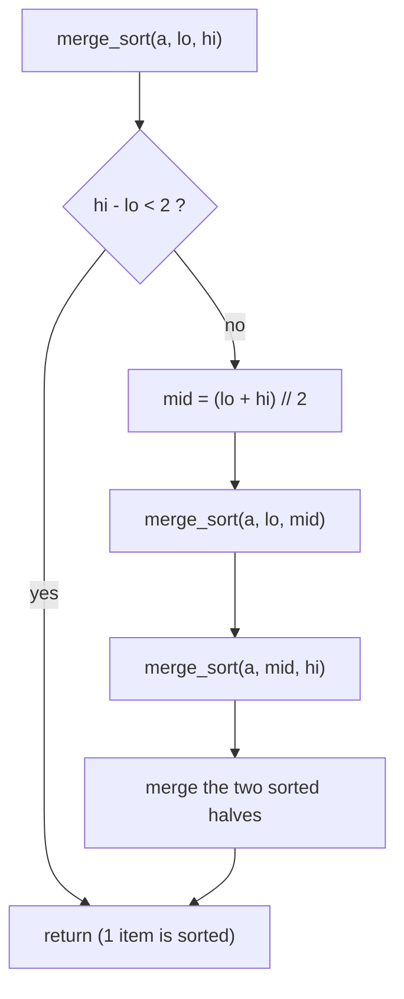

# Merge Sort

> Divide the array in half, sort each half, then merge the two sorted halves.


[← All algorithms](../README.md) · Source: [`algorithms/sorting/merge_sort.py`](../algorithms/sorting/merge_sort.py) ·
Original hand-drawn notes: [`screenshots/merge_sort.png`](screenshots/merge_sort.png)

## Quick answers

**What is the time complexity of merge sort?**  
Best case **O(n log n)**, average case **O(n log n)**, worst case **O(n log n)** (normal tier; the optimized tier differ - see the table below).

**What is the space complexity of merge sort?**  
**O(n)** extra space (normal tier).

**Best case / average case / worst case - what input causes each?**  
- **Best:** sorted → 192 comparisons at n = 64 (normal tier)
- **Average:** random → 307 comparisons at n = 64 (normal tier)
- **Worst:** perfectly interleaving permutation → 321 comparisons at n = 64 (normal tier)

**Is it stable / in place / adaptive?**  
Stable: Yes · In place: No (needs O(n) extra) · Adaptive: Only in the optimized tier

**Normal vs optimal vs optimized solution?**  
See [section 6](#6-normal-vs-optimal-vs-optimized-solutions).

**Merge sort or quick sort?**  
Merge sort: guaranteed O(n log n) + stable but needs O(n) memory. Quick sort: in place and usually faster in practice, but the worst case needs care (see the optimized tier).


### Complexity at a glance

| Tier | Best | Average | Worst | Space |
|---|---|---|---|---|
| **Normal** | O(n log n) | O(n log n) | O(n log n) | O(n) |
| **Optimal** | O(n log n) | O(n log n) | O(n log n) | O(n) |
| **Optimized** | O(n) | O(n log n) | O(n log n) | O(n) |

## 1. How it works - step by step



1. **Divide:** split the array at the middle into a left and a right half.
2. **Conquer:** sort each half by calling merge sort on it (a 0- or 1-item array is already sorted - this stops the recursion).
3. **Merge:** keep one pointer at the front of each sorted half; repeatedly copy the **smaller** front item to the output and advance that pointer. When one half runs out, copy the rest of the other.
4. Because the left item wins ties (`<=`), equal items keep their order: merge sort is **stable**.

## 2. Worked example

Sorting the example below, one step at a time (every row is a snapshot taken by
[`tools/tracers.py`](../tools/tracers.py), which is tested to end in the right answer).

| # | What happens | Array after the step |
|---|---|---|
| 1 | Start: unsorted array. | `[5, 2, 4, 6, 1, 3]` |
| 2 | Split [5, 2, 4, 6, 1, 3] into [5, 2, 4] and [6, 1, 3]. | `[5, 2, 4, 6, 1, 3]` |
| 3 | Split [5, 2, 4] into [5] and [2, 4]. | `[5, 2, 4, 6, 1, 3]` |
| 4 | Split [2, 4] into [2] and [4]. | `[5, 2, 4, 6, 1, 3]` |
| 5 | Merge [2] + [4] -> [2, 4]. | `[5, 2, 4, 6, 1, 3]` |
| 6 | Merge [5] + [2, 4] -> [2, 4, 5]. | `[2, 4, 5, 6, 1, 3]` |
| 7 | Split [6, 1, 3] into [6] and [1, 3]. | `[2, 4, 5, 6, 1, 3]` |
| 8 | Split [1, 3] into [1] and [3]. | `[2, 4, 5, 6, 1, 3]` |
| 9 | Merge [1] + [3] -> [1, 3]. | `[2, 4, 5, 6, 1, 3]` |
| 10 | Merge [6] + [1, 3] -> [1, 3, 6]. | `[2, 4, 5, 1, 3, 6]` |
| 11 | Merge [2, 4, 5] + [1, 3, 6] -> [1, 2, 3, 4, 5, 6]. | `[1, 2, 3, 4, 5, 6]` |
| 12 | Sorted. | `[1, 2, 3, 4, 5, 6]` |

## 3. Visual cases - best, average, worst


The picture shows the **input** that triggers each case. Bars are values (sorting) or sorted/unsorted data
with the searched key highlighted (searching).

**Comparisons, n = 64** (each cell: count and the input that produced it)

| Tier | Best | Average | Worst |
|---|---|---|---|
| **Normal** | 192 <br><sub>sorted</sub> | 307 <br><sub>random</sub> | 321 <br><sub>perfectly interleaving permutation</sub> |
| **Optimal** | 192 <br><sub>sorted</sub> | 307 <br><sub>random</sub> | 321 <br><sub>perfectly interleaving permutation</sub> |
| **Optimized** | 63 <br><sub>sorted</sub> | 349 <br><sub>random</sub> | 416 <br><sub>interleaving permutation, reversed leaves</sub> |

| Tier | Extra memory (KiB, n=3000 random) | Max call-stack depth (n=800 sorted) | Time (ms, n=2000 random) |
|---|---|---|---|
| **Normal** | 47.0 | 11 | 2.8 |
| **Optimal** | 35.3 | 12 | 2.6 |
| **Optimized** | 35.3 | 10 | 2.2 |

<sub>Timings are indicative only (CPython 3.13.16, one machine); comparison counts, memory and stack depth are deterministic.</sub>


## 4. Time complexity - step by step

1. **Levels.** Halving n until size 1 takes log₂ n levels.
2. **Work per level.** On each level the merges together touch all n items once: ≤ n−1 comparisons (and exactly n writes).
3. **Total = n × log₂ n → O(n log n)**, written as the recurrence T(n) = 2·T(n/2) + O(n).
4. **Best case:** halves already in order - each merge ends after n/2 comparisons → (n/2)·log₂ n, still O(n log n). The optimized tier checks `a[mid-1] <= a[mid]` and skips the merge, giving **O(n)**.
5. **Worst case:** merges that interleave perfectly use n−1 comparisons each → n·log₂ n − n + 1. **Average** is within ~10% of that. No input can push it past O(n log n).


## 5. Space complexity - step by step

1. Merging needs somewhere to put items while pointers move → an **auxiliary buffer**.
2. Normal tier allocates new `left`/`right` lists at every level (peak ≈ 2n items).
3. Optimal tier reuses **one buffer of n/2** items for the whole sort → **O(n)** extra.
4. Recursion adds O(log n) stack frames - dominated by the O(n) buffer.

## 6. Normal vs optimal vs optimized solutions

| | Normal | Optimal | Optimized |
|---|---|---|---|
| **Idea** | Slice into new left/right lists, sort recursively, merge back. | One reusable half-size buffer; merge in place into the original list. | Add an **insertion-sort cutoff** for ranges ≤ 8 and **skip** the merge when the two halves are already ordered. |
| **Why it matters** | Simple; allocates at every level. | Same O(n log n); less memory and far fewer allocations. | Sorted input becomes O(n); fewer function calls. Honest trade-off: on adversarial inputs it can use *more* comparisons than the normal tier (insertion sort on 8-item leaves) - the win is fewer calls and the O(n) sorted case. Same ideas Python's Timsort builds on. |

*Normal* = the textbook version. *Optimal* = the best Big-O this algorithm family can reach.
*Optimized* = engineering tweaks you would ship (constant factors, memory, robustness).

### Normal - `merge_sort_normal`

**Idea:** Slice into new left/right lists, sort recursively, merge back.

Simple; allocates at every level.

| Best | Average | Worst | Space |
|---|---|---|---|
| O(n log n) | O(n log n) | O(n log n) | O(n) |

```python
def merge_sort_normal(arr):
    """Normal: slice into new left/right lists at every level, merge back into arr."""
    if len(arr) > 1:
        mid = len(arr) // 2
        left, right = arr[:mid], arr[mid:]
        merge_sort_normal(left)
        merge_sort_normal(right)
        i = j = k = 0
        while i < len(left) and j < len(right):
            if left[i] <= right[j]:             # <= keeps equal items in original order
                arr[k] = left[i]
                i += 1
            else:
                arr[k] = right[j]
                j += 1
            k += 1
        while i < len(left):
            arr[k] = left[i]
            i += 1
            k += 1
        while j < len(right):
            arr[k] = right[j]
            j += 1
            k += 1
    return arr
```

### Optimal - `merge_sort_optimal`

**Idea:** One reusable half-size buffer; merge in place into the original list.

Same O(n log n); less memory and far fewer allocations.

| Best | Average | Worst | Space |
|---|---|---|---|
| O(n log n) | O(n log n) | O(n log n) | O(n) |

```python
def merge_sort_optimal(arr):
    """Optimal: ONE reusable half-size buffer instead of fresh lists at every level."""
    _sort(arr, [None] * (len(arr) // 2 + 1), 0, len(arr))
    return arr
```

### Optimized - `merge_sort_optimized`

**Idea:** Add an **insertion-sort cutoff** for ranges ≤ 8 and **skip** the merge when the two halves are already ordered.

Sorted input becomes O(n); fewer function calls. Honest trade-off: on adversarial inputs it can use *more* comparisons than the normal tier (insertion sort on 8-item leaves) - the win is fewer calls and the O(n) sorted case. Same ideas Python's Timsort builds on.

| Best | Average | Worst | Space |
|---|---|---|---|
| O(n) | O(n log n) | O(n log n) | O(n) |

```python
def merge_sort_optimized(arr):
    """Optimized: single half-size buffer + insertion-sort cutoff for tiny ranges + skip merges of
    already-ordered halves (makes sorted input O(n)).  Same ideas as Python's Timsort."""
    _sort_fast(arr, [None] * (len(arr) // 2 + 1), 0, len(arr))
    return arr
```

## 7. When to use it

You need guaranteed O(n log n), a **stable** sort, or you are sorting linked lists / data on disk (external merge sort). Avoid when memory is tight.

## Further reading

- [Time and Space Complexities of Sorting Algorithms Explained (Interview Kickstart)](https://interviewkickstart.com/blogs/learn/time-complexities-of-all-sorting-algorithms)
- [Sorting Algorithms Cheat Sheet (NeetCode)](https://neetcode.io/cheatsheets/sorting-algorithms)
- [Introsort (Wikipedia)](https://en.wikipedia.org/wiki/Introsort)
- [Timsort (Wikipedia)](https://en.wikipedia.org/wiki/Timsort)
- [Introspective Sorting and Selection Algorithms - Musser (PDF)](https://webpages.charlotte.edu/rbunescu/courses/ou/cs4040/introsort.pdf)
