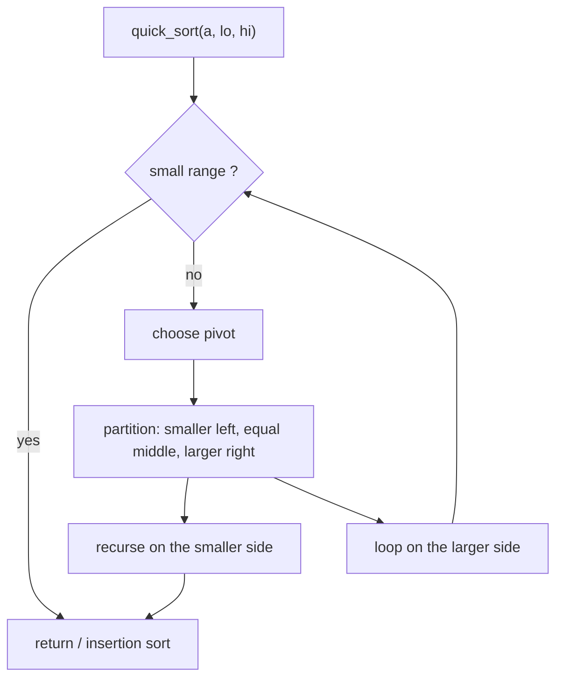

# Quick Sort

> Pick a pivot, put smaller items on its left and larger on its right, then sort both sides the same way.


[← All algorithms](../README.md) · Source: [`algorithms/sorting/quick_sort.py`](../algorithms/sorting/quick_sort.py) ·
Original hand-drawn notes: [`screenshots/quick_sort.png`](screenshots/quick_sort.png)

## Quick answers

**What is the time complexity of quick sort?**  
Best case **O(n log n)**, average case **O(n log n)**, worst case **O(n²)** (normal tier; the optimal and optimized tiers differ - see the table below).

**What is the space complexity of quick sort?**  
**O(n) worst / O(log n) average** extra space (normal tier); other tiers: optimal O(log n), optimized O(log n).

**Best case / average case / worst case - what input causes each?**  
- **Best:** balanced-pivot permutation → 264 comparisons at n = 64 (normal tier)
- **Average:** random → 362 comparisons at n = 64 (normal tier)
- **Worst:** sorted → 2,016 comparisons at n = 64 (normal tier)

**Is it stable / in place / adaptive?**  
Stable: No · In place: Yes (normal tier copies) · Adaptive: Optimized tier handles sorted/equal input

**Normal vs optimal vs optimized solution?**  
See [section 6](#6-normal-vs-optimal-vs-optimized-solutions).

**Why is quick sort's worst case O(n²) but it is still popular?**  
The worst case needs consistently terrible pivots. Randomization or median-of-three makes that vanishingly rare, and introsort makes it impossible.


### Complexity at a glance

| Tier | Best | Average | Worst | Space |
|---|---|---|---|---|
| **Normal** | O(n log n) | O(n log n) | O(n²) | O(n) worst / O(log n) average |
| **Optimal** | O(n log n) | O(n log n) | O(n²) (duplicates; astronomically rare otherwise) | O(log n) |
| **Optimized** | O(n) (all equal) | O(n log n) | O(n log n) | O(log n) |

## 1. How it works - step by step



1. **Pick a pivot** (normal tier: the last element; optimal: random; optimized: median of first/middle/last).
2. **Partition:** rearrange so that everything smaller than the pivot is to its left and everything larger to its right. The pivot is now in its **final** position.
3. **Recurse** on the left part and on the right part (a part with 0 or 1 items is done).
4. No merge step is needed - once both sides are sorted the whole range is sorted.
5. **Optimized tier extras:** 3-way partition (items equal to the pivot are finished at once), insertion sort for ranges ≤ 16, recurse on the smaller side first, and fall back to heap sort if recursion gets deeper than 2·log₂ n (this combination is called **introsort**).

## 2. Worked example

Sorting the example below, one step at a time (every row is a snapshot taken by
[`tools/tracers.py`](../tools/tracers.py), which is tested to end in the right answer).

| # | What happens | Array after the step |
|---|---|---|
| 1 | Start: unsorted array. | `[5, 2, 4, 6, 1, 3]` |
| 2 | Range [5, 2, 4, 6, 1, 3]: pivot = last item = 3. | `[5, 2, 4, 6, 1, 3]` |
| 3 | Partition: smaller items left, larger right. Pivot 3 is final at index 2. | `[2, 1, 3, 6, 5, 4]` |
| 4 | Range [2, 1]: pivot = last item = 1. | `[2, 1, 3, 6, 5, 4]` |
| 5 | Partition: smaller items left, larger right. Pivot 1 is final at index 0. | `[1, 2, 3, 6, 5, 4]` |
| 6 | Range [6, 5, 4]: pivot = last item = 4. | `[1, 2, 3, 6, 5, 4]` |
| 7 | Partition: smaller items left, larger right. Pivot 4 is final at index 3. | `[1, 2, 3, 4, 5, 6]` |
| 8 | Range [5, 6]: pivot = last item = 6. | `[1, 2, 3, 4, 5, 6]` |
| 9 | Partition: smaller items left, larger right. Pivot 6 is final at index 5. | `[1, 2, 3, 4, 5, 6]` |
| 10 | Sorted. | `[1, 2, 3, 4, 5, 6]` |

## 3. Visual cases - best, average, worst


The picture shows the **input** that triggers each case. Bars are values (sorting) or sorted/unsorted data
with the searched key highlighted (searching).

**Comparisons, n = 64** (each cell: count and the input that produced it)

| Tier | Best | Average | Worst |
|---|---|---|---|
| **Normal** | 264 <br><sub>balanced-pivot permutation</sub> | 362 <br><sub>random</sub> | 2,016 <br><sub>sorted</sub> |
| **Optimal** | 336 <br><sub>reversed</sub> | 367 <br><sub>random</sub> | 2,016 <br><sub>all equal</sub> |
| **Optimized** | 131 <br><sub>all equal</sub> | 483 <br><sub>random</sub> | 666 <br><sub>balanced-pivot permutation</sub> |

| Tier | Extra memory (KiB, n=3000 random) | Max call-stack depth (n=800 sorted) | Time (ms, n=2000 random) |
|---|---|---|---|
| **Normal** | 102.7 | 800 | 1.6 |
| **Optimal** | 1.0 | 10 | 2.4 |
| **Optimized** | 1.0 | 7 | 2.5 |

<sub>Timings are indicative only (CPython 3.13.16, one machine); comparison counts, memory and stack depth are deterministic.</sub>


## 4. Time complexity - step by step

1. **Cost of one partition** of k items = k−1 comparisons → O(k).
2. **Best / average (balanced splits).** The pivot lands near the middle: T(n) = 2·T(n/2) + O(n) → **O(n log n)**. For random pivots the expected count is ≈ 2·n·ln n ≈ 1.39·n·log₂ n comparisons.
3. **Worst case (pivot is always the min or max).** One side is empty: T(n) = T(n−1) + O(n) → n(n−1)/2 → **O(n²)**. With a *last-element* pivot this is triggered by **already-sorted, reversed or all-equal input** - common real-world data!
4. **Fixes.** Random pivot: no fixed bad input. Median-of-three: kills sorted/reversed input. 3-way partition: kills all-equal input. Introsort depth limit: even adversarial inputs stay O(n log n).


## 5. Space complexity - step by step

1. Normal tier builds new lower/greater lists at each level (O(n) extra) and recurses up to **n deep** on bad input → O(n) stack - on a 1000-item sorted list Python hits its recursion limit.
2. Optimal/optimized tiers partition **in place** and always recurse into the **smaller** side first (looping on the larger), so the stack never exceeds log₂ n frames → **O(log n)**.

## 6. Normal vs optimal vs optimized solutions

| | Normal | Optimal | Optimized |
|---|---|---|---|
| **Idea** | Last element as pivot; build `lower` and `greater` lists; concatenate. | In-place Lomuto partition + **random pivot** + recurse into the smaller side. | **Introsort**: median-of-three pivot, 3-way partition, insertion-sort cutoff (16), smaller-side recursion, heap-sort fallback at depth 2·log₂ n. |
| **Why it matters** | Easy to read. O(n²) on sorted/reversed/all-equal input, O(n) recursion depth. | Expected O(n log n) for any input order and O(log n) stack. (Many duplicates still hurt Lomuto.) | Guaranteed O(n log n) worst case and O(n) on all-equal input. It may count slightly *more* comparisons than the random-pivot version on random data (the insertion-sort cutoff) but makes fewer calls. This is the design behind C++ `std::sort`. |

*Normal* = the textbook version. *Optimal* = the best Big-O this algorithm family can reach.
*Optimized* = engineering tweaks you would ship (constant factors, memory, robustness).

### Normal - `quick_sort_normal`

**Idea:** Last element as pivot; build `lower` and `greater` lists; concatenate.

Easy to read. O(n²) on sorted/reversed/all-equal input, O(n) recursion depth.

| Best | Average | Worst | Space |
|---|---|---|---|
| O(n log n) | O(n log n) | O(n²) | O(n) worst / O(log n) average |

```python
def quick_sort_normal(arr):
    """Normal: last element is the pivot, build new lists (O(n) extra per level).

    Worst case: sorted, reversed or all-equal input - the pivot is always the min/max,
    so one side is empty and recursion goes n levels deep.
    """
    if len(arr) <= 1:
        return arr
    pivot = arr[-1]
    lower, greater = [], []
    for x in arr[:-1]:                          # one pass, one comparison per item
        (lower if x < pivot else greater).append(x)
    arr[:] = quick_sort_normal(lower) + [pivot] + quick_sort_normal(greater)
    return arr
```

### Optimal - `quick_sort_optimal`

**Idea:** In-place Lomuto partition + **random pivot** + recurse into the smaller side.

Expected O(n log n) for any input order and O(log n) stack. (Many duplicates still hurt Lomuto.)

| Best | Average | Worst | Space |
|---|---|---|---|
| O(n log n) | O(n log n) | O(n²) (duplicates; astronomically rare otherwise) | O(log n) |

```python
def quick_sort_optimal(arr):
    """Optimal: in-place partition + random pivot -> expected O(n log n), O(log n) stack.

    (Lomuto still degrades to O(n^2) on many duplicates - the optimized version fixes that.)
    """
    _quick_random(arr, 0, len(arr) - 1)
    return arr
```

### Optimized - `quick_sort_optimized`

**Idea:** **Introsort**: median-of-three pivot, 3-way partition, insertion-sort cutoff (16), smaller-side recursion, heap-sort fallback at depth 2·log₂ n.

Guaranteed O(n log n) worst case and O(n) on all-equal input. It may count slightly *more* comparisons than the random-pivot version on random data (the insertion-sort cutoff) but makes fewer calls. This is the design behind C++ `std::sort`.

| Best | Average | Worst | Space |
|---|---|---|---|
| O(n) (all equal) | O(n log n) | O(n log n) | O(log n) |

```python
def quick_sort_optimized(arr):
    """Optimized: introsort-style.

    median-of-three pivot (kills sorted/reversed worst cases) + 3-way partition (equal
    keys cost O(n), not O(n^2)) + insertion sort for tiny ranges + smaller-side recursion
    + heap-sort fallback when depth exceeds 2*log2(n).  Worst case O(n log n).
    """
    _intro(arr, 0, len(arr) - 1, 2 * len(arr).bit_length())
    return arr
```

## 7. When to use it

General-purpose in-memory sorting where average speed matters. Use the optimized tier (or the library sort) - not the textbook version - on real data.

## Further reading

- [Time and Space Complexities of Sorting Algorithms Explained (Interview Kickstart)](https://interviewkickstart.com/blogs/learn/time-complexities-of-all-sorting-algorithms)
- [Sorting Algorithms Cheat Sheet (NeetCode)](https://neetcode.io/cheatsheets/sorting-algorithms)
- [Introsort (Wikipedia)](https://en.wikipedia.org/wiki/Introsort)
- [Timsort (Wikipedia)](https://en.wikipedia.org/wiki/Timsort)
- [Introspective Sorting and Selection Algorithms - Musser (PDF)](https://webpages.charlotte.edu/rbunescu/courses/ou/cs4040/introsort.pdf)
