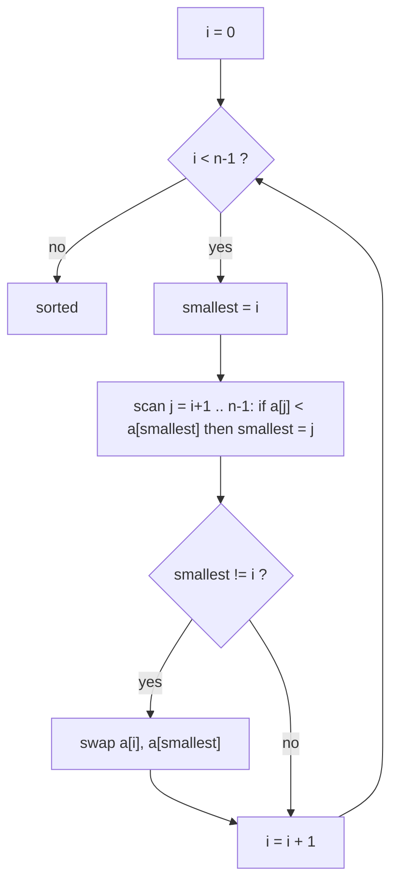

# Selection Sort

> Find the smallest remaining value and swap it to the front, again and again.


[← All algorithms](../README.md) · Source: [`algorithms/sorting/selection_sort.py`](../algorithms/sorting/selection_sort.py) ·
Original hand-drawn notes: [`screenshots/selection_sort.png`](screenshots/selection_sort.png)

## Quick answers

**What is the time complexity of selection sort?**  
Best case **O(n²)**, average case **O(n²)**, worst case **O(n²)** (optimal tier; the same for every tier).

**What is the space complexity of selection sort?**  
**O(1)** extra space (optimal tier).

**Best case / average case / worst case - what input causes each?**  
- **Best:** sorted → 2,016 comparisons at n = 64 (optimal tier)
- **Average:** random → 2,016 comparisons at n = 64 (optimal tier)
- **Worst:** sorted → 2,016 comparisons at n = 64 (optimal tier)

**Is it stable / in place / adaptive?**  
Stable: No · In place: Yes · Adaptive: No

**Normal vs optimal vs optimized solution?**  
See [section 6](#6-normal-vs-optimal-vs-optimized-solutions).

**Why isn't selection sort stable?**  
Sorting `[2a, 2b, 1]`: swapping `1` with `2a` puts `2a` *after* `2b`, so equal keys change order.


### Complexity at a glance

| Tier | Best | Average | Worst | Space |
|---|---|---|---|---|
| **Normal** | O(n²) | O(n²) | O(n²) | O(1) |
| **Optimal** | O(n²) | O(n²) | O(n²) | O(1) |
| **Optimized** | O(n²) | O(n²) | O(n²) | O(1) |

## 1. How it works - step by step



1. Treat the array as two parts: a **sorted** prefix (empty at first) and an **unsorted** rest.
2. Scan the whole unsorted part and remember where the **smallest** value is.
3. Swap that smallest value with the first unsorted slot. The sorted prefix grows by one.
4. Repeat until only one unsorted item remains (it is automatically the largest, so it's in place).

## 2. Worked example

Sorting the example below, one step at a time (every row is a snapshot taken by
[`tools/tracers.py`](../tools/tracers.py), which is tested to end in the right answer).

| # | What happens | Array after the step |
|---|---|---|
| 1 | Start: unsorted array. | `[5, 2, 4, 6, 1, 3]` |
| 2 | Smallest of [5, 2, 4, 6, 1, 3] is 1: swap it to index 0. | `[1, 2, 4, 6, 5, 3]` |
| 3 | Smallest of [2, 4, 6, 5, 3] is 2, already at index 1: no swap. | `[1, 2, 4, 6, 5, 3]` |
| 4 | Smallest of [4, 6, 5, 3] is 3: swap it to index 2. | `[1, 2, 3, 6, 5, 4]` |
| 5 | Smallest of [6, 5, 4] is 4: swap it to index 3. | `[1, 2, 3, 4, 5, 6]` |
| 6 | Smallest of [5, 6] is 5, already at index 4: no swap. | `[1, 2, 3, 4, 5, 6]` |
| 7 | Sorted. | `[1, 2, 3, 4, 5, 6]` |

## 3. Visual cases - best, average, worst


The picture shows the **input** that triggers each case. Bars are values (sorting) or sorted/unsorted data
with the searched key highlighted (searching).

**Comparisons, n = 64** (each cell: count and the input that produced it)

| Tier | Best | Average | Worst |
|---|---|---|---|
| **Normal** | 2,016 <br><sub>sorted</sub> | 2,016 <br><sub>random</sub> | 2,016 <br><sub>sorted</sub> |
| **Optimal** | 2,016 <br><sub>sorted</sub> | 2,016 <br><sub>random</sub> | 2,016 <br><sub>sorted</sub> |
| **Optimized** | 1,584 <br><sub>sorted</sub> | 1,584 <br><sub>random</sub> | 1,584 <br><sub>sorted</sub> |

| Tier | Extra memory (KiB, n=3000 random) | Max call-stack depth (n=800 sorted) | Time (ms, n=2000 random) |
|---|---|---|---|
| **Normal** | 0.3 | 1 | 98.3 |
| **Optimal** | 0.3 | 1 | 57.1 |
| **Optimized** | 0.2 | 1 | 49.0 |

<sub>Timings are indicative only (CPython 3.13.16, one machine); comparison counts, memory and stack depth are deterministic.</sub>


## 4. Time complexity - step by step

1. **Count the comparisons.** Finding the minimum of k items always costs k−1 comparisons - there is no shortcut, even if the data is sorted. Passes scan n−1, n−2, …, 1 items → **n(n−1)/2** every time.
2. **Best = average = worst = O(n²).** Selection sort cannot notice that the data is already sorted.
3. **Swaps are the one cheap part:** at most one per pass → **≤ n−1 swaps (O(n))**, the fewest of any simple sort. Use it when writing is expensive.


## 5. Space complexity - step by step

1. Only `smallest`, `i`, `j` and a swap temporary → **O(1)**, in place, no recursion.

## 6. Normal vs optimal vs optimized solutions

| | Normal | Optimal | Optimized |
|---|---|---|---|
| **Idea** | Textbook version: always swap, even with itself. | Skip the last pass and skip swaps when the minimum is already in place. | **Double-ended selection**: each pass places the minimum **and** the maximum, comparing items in pairs (3 comparisons per 2 items instead of 4). |
| **Why it matters** | n(n−1)/2 comparisons in every case. | The comparison count cannot be improved for this method - it is already optimal *for selection sort*. For a better class, use heap sort: selection sort + a heap that finds each minimum in O(log n). | About 25% fewer comparisons and half the passes. Still O(n²). |

*Normal* = the textbook version. *Optimal* = the best Big-O this algorithm family can reach.
*Optimized* = engineering tweaks you would ship (constant factors, memory, robustness).

### Normal - `selection_sort_normal`

**Idea:** Textbook version: always swap, even with itself.

n(n−1)/2 comparisons in every case.

| Best | Average | Worst | Space |
|---|---|---|---|
| O(n²) | O(n²) | O(n²) | O(1) |

```python
def selection_sort_normal(arr):
    """Normal: find the minimum of the unsorted part, swap it to the front."""
    n = len(arr)
    for i in range(n):
        smallest = i
        for j in range(i + 1, n):
            if arr[j] < arr[smallest]:
                smallest = j
        arr[smallest], arr[i] = arr[i], arr[smallest]
    return arr
```

### Optimal - `selection_sort_optimal`

**Idea:** Skip the last pass and skip swaps when the minimum is already in place.

The comparison count cannot be improved for this method - it is already optimal *for selection sort*. For a better class, use heap sort: selection sort + a heap that finds each minimum in O(log n).

| Best | Average | Worst | Space |
|---|---|---|---|
| O(n²) | O(n²) | O(n²) | O(1) |

```python
def selection_sort_optimal(arr):
    """Optimal: identical comparison count - n(n-1)/2 can't be improved for this method.

    Only trims busywork: the last element needs no pass, and a swap is skipped when the
    minimum is already in place.  Its real selling point is the minimum NUMBER OF WRITES
    (<= n-1 swaps), useful when writing is expensive (flash memory).
    For a better complexity class switch algorithms: heap sort is "selection sort with
    a heap" and finds each minimum in O(log n).
    """
    n = len(arr)
    for i in range(n - 1):
        smallest = i
        for j in range(i + 1, n):
            if arr[j] < arr[smallest]:
                smallest = j
        if smallest != i:
            arr[smallest], arr[i] = arr[i], arr[smallest]
    return arr
```

### Optimized - `selection_sort_optimized`

**Idea:** **Double-ended selection**: each pass places the minimum **and** the maximum, comparing items in pairs (3 comparisons per 2 items instead of 4).

About 25% fewer comparisons and half the passes. Still O(n²).

| Best | Average | Worst | Space |
|---|---|---|---|
| O(n²) | O(n²) | O(n²) | O(1) |

```python
def selection_sort_optimized(arr):
    """Optimized: double-ended selection - place the min AND the max in every pass.

    Handles two elements per pass (half the passes) and uses the "compare the pair
    first" trick: 3 comparisons per 2 elements instead of 4, ~25% fewer than normal.
    Still O(n^2).
    """
    lo, hi = 0, len(arr) - 1
    while lo < hi:
        small = big = lo
        j = lo
        while j < hi:                           # walk the window in pairs
            a, b = j, j + 1
            if arr[b] < arr[a]:
                a, b = b, a                     # now arr[a] <= arr[b]
            if arr[a] < arr[small]:
                small = a
            if arr[big] < arr[b]:
                big = b
            j += 2
        if j == hi:                             # odd leftover element
            if arr[j] < arr[small]:
                small = j
            elif arr[big] < arr[j]:
                big = j
        arr[lo], arr[small] = arr[small], arr[lo]
        if big == lo:                           # the max was just moved by the swap above
            big = small
        arr[hi], arr[big] = arr[big], arr[hi]
        lo += 1
        hi -= 1
    return arr
```

## 7. When to use it

When the number of writes must be minimal (flash memory, expensive swaps) and n is small.

## Further reading

- [Time and Space Complexities of Sorting Algorithms Explained (Interview Kickstart)](https://interviewkickstart.com/blogs/learn/time-complexities-of-all-sorting-algorithms)
- [Sorting Algorithms Cheat Sheet (NeetCode)](https://neetcode.io/cheatsheets/sorting-algorithms)
- [Introsort (Wikipedia)](https://en.wikipedia.org/wiki/Introsort)
- [Timsort (Wikipedia)](https://en.wikipedia.org/wiki/Timsort)
- [Introspective Sorting and Selection Algorithms - Musser (PDF)](https://webpages.charlotte.edu/rbunescu/courses/ou/cs4040/introsort.pdf)
